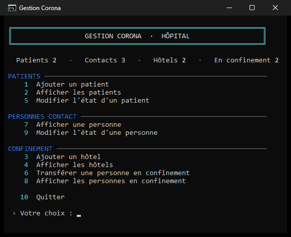
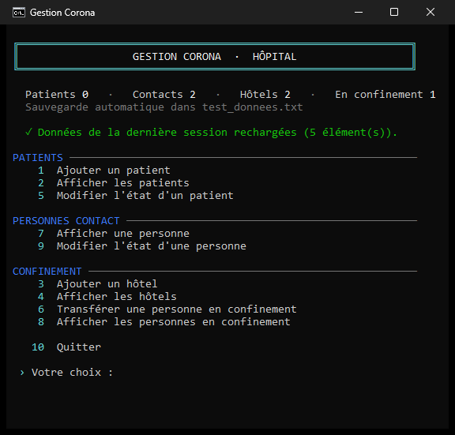
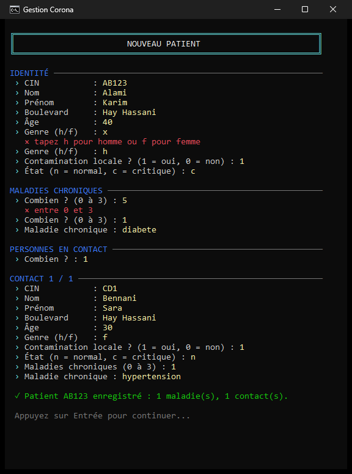
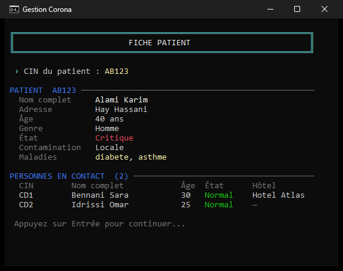
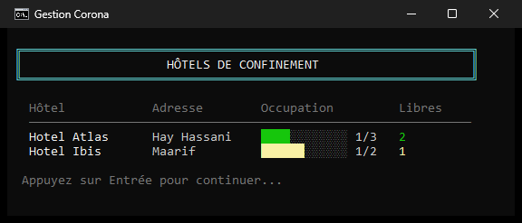
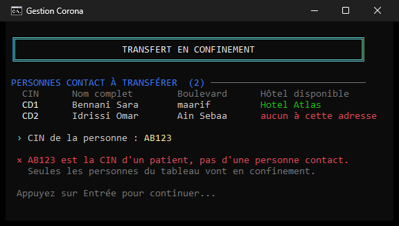
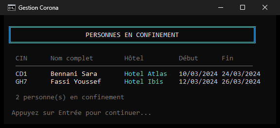
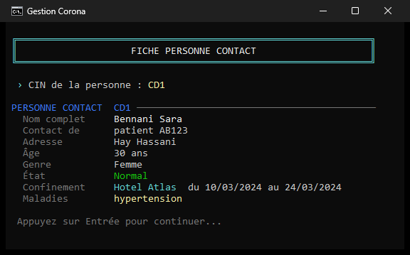
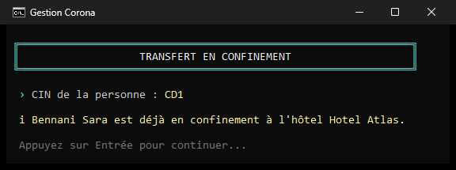

# Gestion Corona

Application console en C pour gérer les patients COVID-19, leurs maladies chroniques, les personnes avec qui ils ont été en contact, et le confinement de ces personnes dans des hôtels.

Projet réalisé par Ahmed Kharbouch (2AP G2, Maârif).



## Fonctionnalités

- **Patients** : ajout (identité, état, maladies chroniques, personnes contact), fiche détaillée, changement d'état, recherche par âge et par genre. Un patient guéri ou décédé est retiré de la liste avec ses maladies.
- **Personnes contact** : fiche, changement d'état.
- **Confinement** :
  - ajout d'hôtels (adresse, nombre de lits) ;
  - transfert d'une personne contact vers un hôtel libre de son boulevard, avec dates de début et de fin ;
  - liste des personnes confinées.
- **Sauvegarde automatique** : les données sont écrites dans `donnees_corona.txt` à côté de `main.exe` après chaque modification, puis rechargées au démarrage.
- **Interface** : couleurs, cadres, tableaux alignés, transitions animées entre les pages. Les saisies sont vérifiées : un texte à la place d'un nombre, une date invalide ou une CIN inconnue ne font pas planter le programme.

## Captures

| Menu principal | Ajout d'un patient |
|---|---|
|  |  |
| **Fiche patient** | **Hôtels** |
|  |  |
| **Transfert en confinement** | **Personnes confinées** |
|  |  |
| **Fiche d'une personne contact** | **Message d'erreur** |
|  |  |

## Compilation

Il faut `gcc` (par exemple [WinLibs](https://winlibs.com/) sous Windows). Depuis le dossier du projet :

```bash
gcc -std=c99 -Wall -Wextra main.c body.c -o output/main.exe
```

Puis lancer `output\main.exe`. Pour un affichage correct, la console doit faire au moins 70 colonnes. Windows Terminal ou la console de Windows 10/11 conviennent.

## Options

| Variable d'environnement | Effet |
|---|---|
| `CORONA_SANS_ANIMATION=1` | désactive les animations |
| `CORONA_FICHIER=chemin` | utilise un autre fichier de sauvegarde |

Pour repartir de zéro, supprimez `output\donnees_corona.txt`.

## Organisation du code

| Fichier | Contenu |
|---|---|
| `head.h` | structures (listes chaînées), couleurs, déclarations |
| `body.c` | affichage, saisie sécurisée, gestion des listes, sauvegarde |
| `main.c` | menu principal |

Le fichier de sauvegarde est un fichier texte lisible, avec un élément par ligne et des champs séparés par `|` :

```
H|nom|adresse|lits occupés|lits max
P|CIN|nom|prénom|adresse|âge|état|genre|nb contacts
M|CIN patient|maladie
C|CIN patient|nom|prénom|adresse|âge|état|genre|conta|début (j|m|a)|fin (j|m|a)|hôtel|CIN
```
